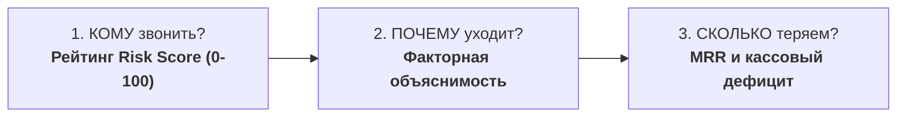
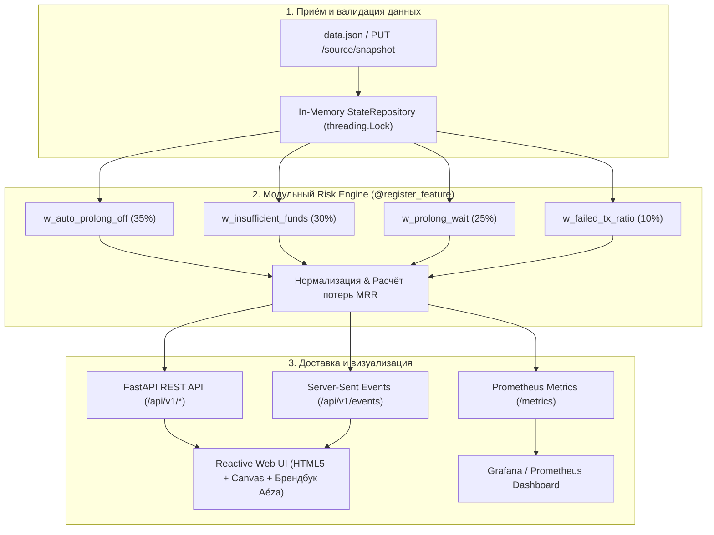

<div align="center">

# ⚡ Aéza Churn Risk Analyzer
### Высокопроизводительный предиктивный скоринг оттока и сохранение регулярной выручки (MRR)

[](https://www.python.org/)
[](https://fastapi.tiangolo.com/)
[](https://www.docker.com/)
[](http://localhost:8000/api/v1/docs)
[](tests/)
[](LICENSE)
[](https://94.228.175.230.sslip.io/)

**Хакатон РНД 2026 · Уровень Middle · Кейс Aéza**  
Команда: **MRBEASTER'ы 2**

🌐 **Онлайн демо-стенд (Nginx + SSL Aéza):** [https://94.228.175.230.sslip.io/](https://94.228.175.230.sslip.io/) • [Swagger UI](https://94.228.175.230.sslip.io/api/v1/docs) • [Prometheus](https://94.228.175.230.sslip.io/metrics)

[🚀 Быстрый старт](#-быстрый-старт) • [📊 3 главных вопроса](#-3-главных-вопроса-бизнеса) • [📐 Модель скоринга](#-математическая-модель-скоринга) • [💰 Финансы & MRR](#-финансовая-модель-и-mrr) • [🏗️ Архитектура](#️-архитектура-решения) • [🔌 API & Swagger](#-api-спецификация-и-эндпоинты) • [🧪 Тесты](#-автотесты)

</div>

---

## 📌 В чём суть проекта

Для хостинг-провайдера критично выявлять клиентов, которые находятся под угрозой отказа от услуг, **до момента физического удаления серверов**.

**Aéza Churn Risk Analyzer** — это микросервисная аналитическая система реального времени, которая переводит сырые технические состояния инфраструктуры (статусы серверов, параметры продления, балансы и транзакции) в **понятные финансовые приоритеты и готовые рекомендации для маркетолога**.

> [!IMPORTANT]
> **Скорость вычислений:** время полного расчёта и скоринга всей клиентской базы составляет **менее 2 миллисекунд** без блокировки потоков.

---

## 🎯 3 главных вопроса бизнеса

Система даёт чёткие ответы на три ключевых вопроса из ТЗ:



1. **Кому требуется внимание?**  
   Каждому аккаунту присваивается персонализированный балл риска (`0–100`), сегмент (`Высокий`, `Средний`, `Низкий`) и обратная метрика лояльности (`Loyalty = 100 - Risk`). Если у клиента нет подключений, система явно фиксирует статус `unknown` (нехватка данных).
2. **Почему возникает риск?**  
   Факторная декомпозиция каждого балла: отключение автопродления (`autoprolong: false`), кассовая нехватка баланса под сумму продлений, зависание в 5-дневном grace-периоде (`prolong_wait`), процент сбоев эквайринга (`not_performed`).
3. **Сколько денег бизнес теряет?**  
   Нормализация всех типов тарифов (от часов до годов) к стандарту **Monthly Recurring Revenue (MRR)**, расчёт матожидания потерь и точного размера кассового разрыва.

---

## 🏗️ Архитектура решения

Решение построено по модульному принципу без избыточных внешних баз данных и тяжёлых фреймворков:



### Ключевые компоненты:
* **Backend:** `Python 3.13`, `FastAPI`, `Pydantic v2`, асинхронный ASGI-сервер `Uvicorn`.
* **State Engine:** потокобезопасный In-Memory репозиторий с атомарной заменой снимка базы и сохранением весов модели в `data/model_settings.json`.
* **Frontend:** zero-dependency Reactive UI (чистый Vanilla JS, HTML5 Canvas с High-DPI рендерингом графиков, поддержка Dark/Light тем strictly по брендбуку Aéza).
* **Live Updates:** Server-Sent Events (SSE) поток на `/api/v1/events` для автообновления интерфейса без перезагрузки при загрузке новых данных или смене весов.
* **Безопасность:** JWT Bearer авторизация + OIDC SSO вход (корпоративный Identity Provider) с возможностью быстрого переключения. Защита от prompt-инъекций (ловушка Слайда 9 ТЗ нейтрализована).

---

## 📐 Математическая модель скоринга

### 4 ключевых признака модели

| Признак | Базовый вес | Описание | Бизнес-обоснование |
| :--- | :---: | :--- | :--- |
| **`w_auto_prolong_off`** | **35%** | Доля услуг с отключенным флагом автопродления (`autoProlong: false`) | Прямое волеизъявление клиента отказаться от автоматической оплаты. |
| **`w_insufficient_funds`** | **30%** | Нехватка средств под сумму продлений: `Balance + Bonus < RenewalCost` | Финансовая невозможность совершить автоплатеж в срок. |
| **`w_prolong_wait`** | **25%** | Наличие услуг в статусе `prolong_wait` (5-дневный льготный grace-период) | Критический сигнал: услуга уже истекла и будет безвозвратно удалена через 5 дней. |
| **`w_failed_tx_ratio`** | **10%** | Доля неуспешных транзакций со статусом `not_performed` | Сигнал технических проблем (заблокированная карта, сбой банка). |

### Итоговые формулы

```math
\text{Risk Score} = \min \left( 100.0, \; \frac{\sum_{i=1}^{n} w_i \cdot \text{RawScore}_i}{\sum_{i=1}^{n} w_i} \times 100 \right)
```

```math
\text{Loyalty Score} = 100.0 - \text{Risk Score}
```

> [!TIP]
> Все веса и пороги настраиваются на лету через веб-интерфейс или эндпоинт `PATCH /api/v1/model/settings` с мгновенным пересчётом всех скоров.

---

## 💰 Финансовая модель и MRR

Для корректной оценки разнородных периодов оплаты стоимость услуг нормализуется к месячной регулярной выручке (**Monthly Recurring Revenue, MRR**):

| Период тарифа (`paymentTerm`) | Множитель к месяцу | Формула приведения к MRR |
| :--- | :---: | :--- |
| **`hour`** (почасовой) | × 720 | MRR = price × 720 |
| **`week`** (еженедельный) | × 4.333 | MRR = price × 4.333 |
| **`month`** (ежемесячный) | × 1.0 | MRR = price × 1.0 |
| **`quarter_year`** (раз в квартал) | × 1/3 | MRR = price / 3 |
| **`half_year`** (раз в полгода) | × 1/6 | MRR = price / 6 |
| **`year`** (годовой) | × 1/12 | MRR = price / 12 |

### Оценка потенциальных потерь (Potential Loss)

```math
\text{Loss} = \sum_{s \in \text{Services}} \left( \text{MRR}_s \times P(\text{churn}) \times \min \left( 1.0, \; \frac{\text{DaysUntilExpiration}}{30} \right) \right)
```

> **Где:**
> * **P(churn) = RiskScore / 100** — вероятность оттока клиента;
> * **DaysUntilExpiration** — количество дней до окончания оплаченного периода.

### Кассовый дефицит (Размер необходимого пополнения)

```math
\text{Deficit} = \max \Big( 0.0, \; \text{RenewalCost} - (\text{Balance} + \text{ActiveBonus}) \Big)
```

> **Где:**
> * **RenewalCost** — суммарная стоимость предстоящих продлений услуг;
> * **Balance** — реальный денежный баланс клиента;
> * **ActiveBonus** — сумма доступных активных бонусов.

---

## 🚀 Быстрый старт

### 🌐 Онлайн демо-стенд (Развёрнуто на сервере Aéza + Nginx SSL)

Проект развёрнут и доступен онлайн (поддерживает как HTTPS с SSL, так и прямой IP):
* 🔒 **Веб-панель (HTTPS / SSL):** [https://94.228.175.230.sslip.io/](https://94.228.175.230.sslip.io/) *(работает на мобильных, в инкогнито и на ПК)*
* 🌐 **Прямой IP (HTTP):** [http://94.228.175.230/](http://94.228.175.230/)
* 📖 **Интерактивный Swagger UI:** [https://94.228.175.230.sslip.io/api/v1/docs](https://94.228.175.230.sslip.io/api/v1/docs)
* 📈 **Метрики Prometheus:** [https://94.228.175.230.sslip.io/metrics](https://94.228.175.230.sslip.io/metrics)
* 🔑 **Учётные данные:** логин `admin`, пароль `aeza2026` (или кнопка Aéza ID OIDC SSO)

---

### Вариант 1. Развёртывание в Docker Compose

Требуется установленный Docker и Docker Compose.

```bash
# Клонирование и переход в репозиторий
git clone https://github.com/your-team/aeza-churn-risk-analyzer.git
cd aeza-churn-risk-analyzer

# Запуск контейнера в фоне
docker compose up --build -d
```

После старта сервис доступен по адресам:
* 🌐 **Веб-интерфейс:** [http://localhost:8000](http://localhost:8000)
* 📖 **Интерактивный Swagger UI:** [http://localhost:8000/api/v1/docs](http://localhost:8000/api/v1/docs) (или `/docs`)
* 📈 **Метрики Prometheus:** [http://localhost:8000/metrics](http://localhost:8000/metrics)

Остановка контейнера:
```bash
docker compose down
```

---

### Вариант 2. Локальный запуск на Python

Требуется **Python 3.10+** (рекомендуется Python 3.13).

```bash
# Создание и активация виртуального окружения
python -m venv .venv
# Для Windows:
.\.venv\Scripts\activate
# Для Linux/macOS:
source .venv/bin/activate

# Установка зависимостей
pip install -r requirements.txt

# Запуск приложения
python -m app.main
```

---

## 🔐 Учётные данные по умолчанию

Система защищена аутентификацией в соответствии со Слайдом 10 ТЗ:

| Поле | Значение |
| :--- | :--- |
| **Логин** | `admin` |
| **Пароль** | `aeza2026` |
| **OIDC SSO** | Поддерживается вход через корпоративный Identity Provider (кнопка в модальном окне) |

---

## 🔌 API Спецификация и Эндпоинты

В корне проекта приложены официальные спецификации:
* [`openapi.json`](openapi.json) — спецификация в формате JSON
* [`openapi.yaml`](openapi.yaml) — спецификация в формате YAML

| Метод | Эндпоинт | Назначение по ТЗ |
| :---: | :--- | :--- |
| `POST` | `/api/v1/auth/login` | Аутентификация, выдача JWT токена и установка Cookie |
| `GET` | `/api/v1/auth/me` | Профиль текущего авторизованного пользователя |
| `POST` | `/api/v1/auth/logout` | Завершение сессии и очистка токена |
| `GET` | `/api/v1/customers` | Список клиентов с оценками риска, фильтрацией и двусторонней сортировкой |
| `GET` | `/api/v1/customers/{id}` | Полная карточка клиента, список серверов, транзакции и факторные объяснения |
| `GET` | `/api/v1/analytics/summary` | Сводные метрики, сумма потерь выручки и точки графика оттока |
| `GET` | `/api/v1/model/settings` | Получение действующих коэффициентов и весов модели |
| `PATCH` | `/api/v1/model/settings` | Обновление весов модели с автоматическим пересчётом на лету |
| `PUT` | `/api/v1/source/snapshot` | Загрузка нового снимка данных (`data.json`) с моментальным пересчётом |
| `GET` | `/metrics` | Метрики для сборщика Prometheus (Loss, Risk, QPS) |
| `GET` | `/api/v1/events` | SSE-поток событий реального времени для веб-интерфейса |

---

## 🧩 Расширение модели: Как добавить новый признак

Движок скоринга построен на базе декларативного реестра признаков `@register_feature`. Добавление нового правила занимает менее 20 строк:

```python
# app/engine/features/my_feature.py
from typing import List
from app.models import Account, Service, Transaction
from app.engine.base import BaseFeature, FeatureResult, EvaluationContext
from app.engine.registry import register_feature

@register_feature
class HighStorageRiskFeature(BaseFeature):
    feature_name = "w_high_storage"
    description = "Пользовательский признак риска"
    default_weight = 15.0

    def compute(
        self,
        account: Account,
        services: List[Service],
        transactions: List[Transaction],
        context: EvaluationContext
    ) -> FeatureResult:
        weight = context.weights.get(self.feature_name, self.default_weight)
        
        # Ваша бизнес-логика:
        has_risk = any(s.price > 5000 and s.status == "prolong_wait" for s in services)
        raw_score = 100.0 if has_risk else 0.0
        weighted_score = (raw_score * weight) / 100.0
        reason = "Крупный тариф находится под угрозой удаления" if has_risk else None

        return FeatureResult(
            feature_name=self.feature_name,
            weight=weight,
            raw_score=raw_score,
            weighted_score=weighted_score,
            reason=reason
        )
```

Импортируйте новый класс в [`app/engine/features/__init__.py`](app/engine/features/__init__.py) — признак автоматически появится в настройках и расчётах.

---

## 🧪 Автотесты

Проект полностью покрыт набором из 15 автоматических тестов (`pytest`):
* Валидация формул нормализации и граничных условий (`min/max`).
* Корректная обработка клиентов без услуг (`unknown risk`).
* Двусторонняя сортировка таблицы по всем числовым и текстовым полям.
* Персистентность сохранения настроек модели на диск.
* Корректность Prometheus-экспортера и соответствие OpenAPI-схемам.

```bash
# Запуск тестов
pytest -v
```

```text
============================= test session starts =============================
collected 15 items

data/test_generate.py ...                                                [ 20%]
tests/test_api.py .......                                                [ 66%]
tests/test_engine.py ....                                                [ 93%]
tests/test_snapshot.py .                                                 [100%]

============================= 15 passed in 1.22s ==============================
```

---

## 👥 Команда разработки

Проект разработан в рамках **Хакатона РНД 2026** командой **MRBEASTER'ы 2**.